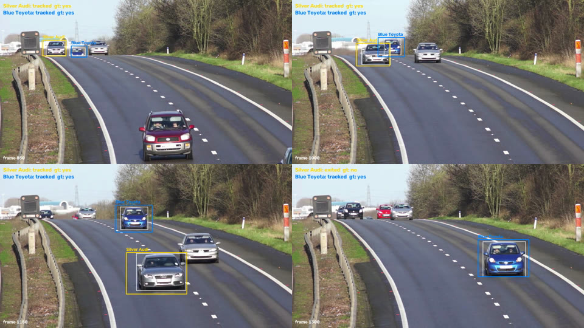

# Classical computer-vision vehicle tracking

This tracks two specific cars through a fixed-camera road clip. The only
description of each car is one cropped photo. No box is drawn by hand in
the video, and no deep learning is used to find or follow the cars. The
pieces are all classical: MOG2 background subtraction, frame differencing,
colour histograms, HOG, SIFT with RANSAC, normalised cross-correlation and a
Kalman filter.

| Target | Reference image | Label in outputs |
| --- | --- | --- |
| A | `refs/1000073924.png` | `Silver Audi` |
| B | `refs/1000073925.png` | `Blue Toyota` |



*Real clip. Coloured boxes are the tracker, thin white boxes are the
detector-based ground truth used for evaluation.*

## Quick start

Everything runs in Docker through `make`. The tracker image is CPU only.

```bash
make setup                      # build the image, create data/ and output/
cp /path/to/1900-151662242.mp4 data/
make track                      # -> output/run/
make test
```

`make help` lists every target. Without Docker:

```bash
pip install -r requirements.txt
python track_vehicles.py --video data/1900-151662242.mp4 --out-dir output/run
```

Outputs:

| File | Contents |
| --- | --- |
| `tracks.csv` | one row per frame per target (see below) |
| `annotated.mp4` | the video with each target boxed in its colour and its status |
| `summary.json` | status counts and first and last located frame per target |
| `candidates.csv` | with `--debug-candidates`: every candidate box and its score against each reference |

## The CSV

`tracks.csv` has one row for every frame and every target. The position
columns (`x, y, w, h, cx, cy, score`) are filled only when the target was
actually measured in that frame. Otherwise they are empty, and `status`
says why.

| `status` | Position? | Meaning |
| --- | --- | --- |
| `searching` | no | Not acquired yet. |
| `tracked` | yes | A moving-object candidate matched the reference and was associated with the track. |
| `tracked_template` | yes | No candidate matched, but a short-range NCC search near the prediction found the car and it still matches the reference. |
| `occluded` | no | The track is alive but there is no reliable measurement. The Kalman prediction is used internally and never written out. |
| `lost` | no | Unmeasured for more than `--max-coast` frames, or the matches kept scoring poorly. Acquisition starts again. |
| `exited` | no | The car drove out of view (its box reached the bottom edge and it is about half out, or the predicted box left the frame). |

Boxes are `x, y, w, h` in original-resolution pixels and `time_s = frame / fps`.

## How it works

The short version is below. `docs/design.md` has the full design and
`docs/literature.md` the survey of methods behind it.

1. Foreground. MOG2 with shadows removed, reinforced by frame differencing
   near existing foreground, then morphology and connected components.
2. Proposals. Neighbouring cars often merge into one blob, so each blob is
   searched for windows with the reference's aspect ratio that best match
   its colour and HOG. Active tracks also search around their Kalman
   prediction.
3. Appearance score against each reference. Hue-saturation and brightness
   histograms (brightness matters for silver cars), HOG, and for patches at
   least 60 px wide a SIFT match verified with RANSAC.
4. Association. Gated by distance and size around the prediction, solved
   jointly so the two targets never share a box. A candidate that looks
   more like the other reference, or scores far below the track's usual
   score, is refused.
5. Occlusion. With no candidate, a local NCC search runs around the
   prediction. If that fails the frame is `occluded` and no box is written.
6. Acquisition. A target starts only when a candidate at least 80 px wide
   (processing pixels) scores 0.80 or more against its reference for 10
   frames in a row, at a consistent place.
7. Two passes. The clip is tracked forwards and then backwards, and the
   two results are merged per frame. Cars drive toward the camera, so they
   can only be identified once they are close. Played backwards, each car
   is picked up while it is large and followed back to where it first
   appeared.
8. Full detection every 5th frame (`--detect-every`). In between, each
   track is followed by a template match at three scales near its Kalman
   prediction, checked against the foreground mask and the colour model.
   Anything doubtful (a weak match, a car leaving the frame, an acquisition
   in progress) sends that frame through the full pipeline instead.

## Results on the real clip

There are no labels for this clip, so I built ground truth for comparison
only. A COCO-trained YOLOv8s runs through TensorRT on every frame, the boxes
are linked into tracklets, and the tracklets that match the two reference
photos best are picked and checked by eye ([contact sheet](docs/gt_contact_sheet.jpg): reference photo first, then crops along each picked tracklet). The deep
model never feeds the tracker. It is also not perfect, so read these as
agreement with a strong detector rather than accuracy against hand labels.

| | recall (IoU 0.5) | precision (IoU 0.3) | identity swaps | boxes where GT has none |
| --- | --- | --- | --- | --- |
| Silver Audi (499 frames in view) | 0.89 | 0.96 | 0 | 0 |
| Blue Toyota (608 frames in view) | 0.81 | 0.96 | 0 | 0 |

The settings that came from tuning on a synthetic clip scored zero on the
real one. They acquired look-alike cars in the first second and never
recovered. `docs/experiments.md` walks through what went wrong, the score
analysis that fixed it, and every run.

Most of the remaining misses are at the far end of each pass, when the car
is under about 100 px wide and looks like several other cars of the same
colour. The tracker reports `searching` there instead of guessing.

## Speed

Measured on a 12-core laptop CPU at the default processing width of 960 px,
tracking only (decoding adds about 10 s for the clip). These were measured
one run at a time, but other work was sometimes running on the machine, so
treat them as approximate. Every run writes its own timing to
`summary.json` under `timing`.

| | full detection every frame | every 5th frame (default) | every 10th frame |
| --- | --- | --- | --- |
| forward only (`--forward-only`) | 6 fps | 23 fps | 39 fps |
| two passes (default) | 3 fps | 11 fps | 18 fps |

Forward-only can run on a live stream and keeps up with a 20 to 25 fps
camera at the default setting. The two-pass mode needs the end of the clip
before it can start, so it is offline only. Every 10th frame is faster but
lets the Audi track slide onto another car for about 50 frames on this clip,
which is why the default is 5. Details are in `docs/experiments.md`.

To rebuild the ground truth you need an NVIDIA GPU and the ONNX model from
the [vehicle-tracker](https://github.com/joeljose/vehicle-tracker) project:

```bash
make build-gt
make gt-all          # copy model, detect every frame, link and pick targets
make eval            # score output/run against gt/gt.json
make compare         # output/run/compare.mp4, tracker vs ground truth
```

## Tuning on new footage

```bash
make track-debug OUT=output/debug
```

`annotated.mp4` then shows every candidate box with its score against each
reference, and `candidates.csv` has the same numbers. Set
`--acquire-threshold` below what the true cars reach when close and above
the best look-alikes. Other options are `--keep-threshold`,
`--identity-threshold`, `--acquire-min-width`, `--confirm-frames`,
`--max-coast`, `--min-area` and `--process-width` (frames wider than this
are downscaled, default 960). `--forward-only` skips the backward pass and
`--detect-every N` sets how often the full detection runs.

## Testing

`make test` runs unit tests and an end-to-end test on a synthetic clip
rendered from the two reference images, with a dark look-alike Audi, a red
hatchback and a full occlusion of the Audi. `make eval-synthetic` prints the
scores on that clip. The synthetic clip only guards behaviour. It is much
easier than real footage, as the baseline above shows.

## Layout

```
track_vehicles.py          CLI: video in, tracks.csv + annotated.mp4 + summary.json out
vtrack/appearance.py       reference appearance models (colour, HOG, SIFT)
vtrack/detection.py        MOG2 + differencing blobs, box helpers
vtrack/kalman.py           constant-velocity box Kalman filter
vtrack/tracker.py          proposals, association, occlusion handling, acquisition
tools/detect_trt.py        YOLOv8 + TensorRT detections (ground truth only)
tools/build_gt.py          link detections, pick the target tracklets
tools/evaluate.py          score tracks.csv against a ground-truth file
tools/compare_video.py     tracker vs ground truth video
tools/make_synthetic_video.py  synthetic test clip
docker/                    CPU image (tracker) and GPU image (ground truth)
docs/                      design, literature survey, experiments
refs/                      the two reference images
```

## Limitations

- A car only a few dozen pixels wide carries too little colour and shape to
  tell apart from similar cars. Those frames stay `searching`.
- When the two targets drive side by side their blob merges, and the box
  can come out loose (IoU between 0.3 and 0.5 with the ground truth).
- The default two-pass mode is offline only and runs at about 11 fps.
  Live use needs `--forward-only`, which loses most of the early, far-away
  frames (recall about 0.5 instead of 0.85).
- A car is called `exited` once it is about half out of the bottom of the
  frame, so its last few partly visible frames are not reported.
- A car of very similar colour and shape, in the same place, during an
  occlusion could still be mistaken for a target. The relative-score check
  reduces this but does not remove it.
